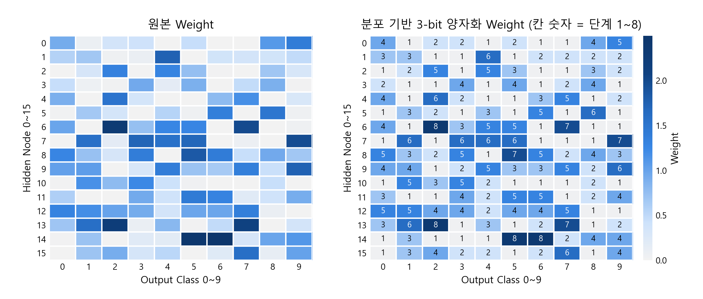
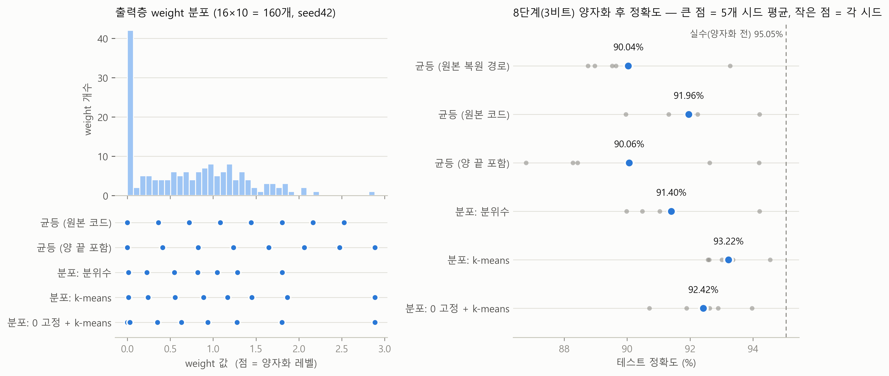
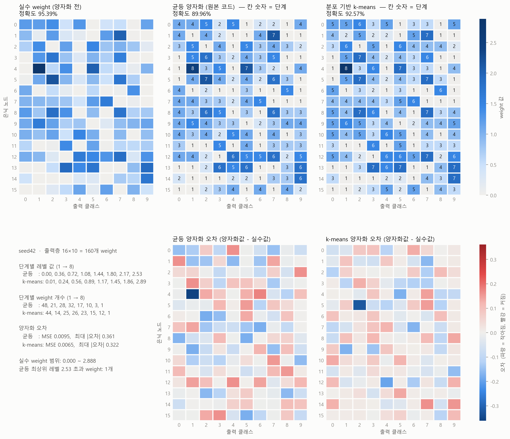

<div align="center">

# 🧠 3-bit Synapse Weight Quantization for SNN Hardware

**MNIST 784×16×10 네트워크 출력층 가중치 3비트 양자화 — 균등(Uniform) vs 분포 기반(k-means)**


</div>

<p align="center">
  
  <br><sub>원본 실수 weight(좌) → 분포 기반 3-bit 양자화 weight(우, 칸 숫자 = 시냅스 단계 1~8)</sub>
</p>

---

## 📌 Overview

뉴로모픽(SNN) 하드웨어에서는 시냅스 소자가 표현할 수 있는 **conductance 단계 수가 제한**되어 있어, 학습된 실수 가중치를 소수의 레벨로 매핑해야 합니다.
이 프로젝트는 16×10 출력층(160개 weight)을 **8단계(3-bit) 시냅스**에 올릴 때, 8개 레벨을 *어떻게 고르느냐*가 정확도에 얼마나 영향을 주는지 비교합니다.

> **핵심 아이디어** — 학습된 weight는 0 근처에 몰려 있고 큰 값은 드뭅니다. 범위를 똑같이 8등분하는 대신 **실제 분포에 맞춰 레벨을 배치(1-D k-means)** 하면 같은 3비트로도 양자화 오차를 줄일 수 있습니다.

## 🏆 Key Results  <sub>(5개 seed 평균, MNIST test 10,000장)</sub>

| Method | Test accuracy | vs. uniform | Weight MSE |
|---|:---:|:---:|:---:|
| Float (양자화 전) | 95.05 % | +3.09 pp | – |
| Uniform (step = range/8) | 91.96 % | – | 0.00736 |
| **Distribution: k-means** | **93.22 %** | **+1.26 pp** | **0.00524** |
| Distribution: 0 fixed + k-means | 92.42 % | +0.46 pp | 0.00686 |
| Distribution: quantile | 91.40 % | −0.56 pp | 0.01296 |

- ✅ k-means가 **5개 seed 모두에서** 균등 양자화보다 높음 (+0.33 ~ +2.61 pp)
- ✅ 실수 대비 정확도 손실을 **3.09 pp → 1.83 pp**로 축소
- ✅ seed 간 표준편차도 1.55 → **0.81**로 감소 → 더 안정적인 매핑

<p align="center">
  
  <br><sub><b>Fig. 1</b> 출력층 weight 분포와 방법별 8개 레벨(좌) · 방법별 테스트 정확도, 큰 점 = 5-seed 평균(우)</sub>
</p>

<p align="center">
  
  <br><sub><b>Fig. 2</b> 실수 / 균등 / k-means weight 히트맵과 weight별 양자화 오차 (seed 42)</sub>
</p>

## ⚙️ Method

| Method | 8개 레벨 결정 방식 |
|---|---|
| `uniform` | `w_min + k·(w_max − w_min)/8`, k = 0…7 (기존 분석 코드; 최상위 레벨이 `w_max`보다 작음) |
| `uniform_pipeline` | 기존 stage → restore 경로; 이미 양자화된 값에서 min/max를 다시 구해 step이 7/8로 줄고 7·8단계가 합쳐짐 |
| `kmeans` | **전역 최적 1-D k-means (dynamic programming)**; 각 레벨 = 클러스터 평균, weight MSE 최소화 |
| `kmeans_zero` | 1단계를 0으로 고정, 나머지 7개 레벨은 양수 weight에 k-means |
| `quantile` | 같은 개수씩 나눈 구간, 각 레벨 = 구간 평균 |

**Network** — 784 → 16 (ReLU) → 10 (softmax). 출력층은 bias 없음 + **non-negative weight constraint**(시냅스 conductance는 음수 불가), Adam, 200 epochs, batch 128, seed 42 / 1 / 2 / 3 / 4.

## 🗂️ Repository Structure

```
SNN/
├── scripts/
│   ├── train_16x10.py        # 네트워크 학습 (seed별)
│   ├── quant_compare.py      # 양자화 방법 비교 · 정확도 측정
│   ├── plot_report.py        # Fig. 1
│   ├── heatmap_report.py     # Fig. 2
│   └── slide_*.py            # 발표용 Figure
├── data/seedN/               # model.keras, raw / quantized weights, train history
├── results/                  # per-run 결과, codebook, 양자화 weight CSV
└── figures/                  # PDF · PNG · metrics.txt · summary.json
```

<details>
<summary><b>🔧 Reproduce</b></summary>

<br>

```bash
pip install tensorflow numpy pandas matplotlib

# 1) 학습 (seed별)
python scripts/train_16x10.py --seed 42 --out data/seed42

# 2) 양자화 비교 → results/, figures/metrics.txt, figures/summary.json
python scripts/quant_compare.py data/seed42 data/seed1 data/seed2 data/seed3 data/seed4

# 3) Figure 생성 → figures/*.pdf, *.png
python scripts/plot_report.py
python scripts/heatmap_report.py
```

각 `data/seedN/`에는 `model.keras`, `weights_01_raw.csv`(16×10 출력층 weight), `weights_02_train_history.csv`, `weights_03_quantized.csv`(균등 양자화)가 있습니다.
Figure 라벨은 한글(Malgun Gothic)입니다.

**Per-seed accuracy (%)**

| seed | float | uniform | k-means | Δ (k-means − uniform) |
|---|:---:|:---:|:---:|:---:|
| 42 | 95.39 | 89.96 | 92.57 | +2.61 |
| 1 | 94.96 | 92.06 | 92.61 | +0.55 |
| 2 | 95.21 | 94.21 | 94.54 | +0.33 |
| 3 | 95.13 | 91.32 | 93.36 | +2.04 |
| 4 | 94.55 | 92.24 | 93.01 | +0.77 |

</details>

---

<div align="center">
<sub>Made by <a href="https://github.com/youngwan12">@youngwan12</a></sub>
</div>
